# EBT - Easy Bridge Testnet

**Bridge, swap and track. Every testnet, one console.**

EBT is a browser-only console for testnet assets: it reads balances straight from each chain,
quotes real routes, signs with your own wallet, and keeps a local ledger of what you did. There is
no account, no backend and no custody. Keys never leave the wallet extension.

**Live demo:** https://ebt-ashy.vercel.app

[](https://ebt-ashy.vercel.app)
[](#what-it-is-not)
[](#architecture)
[](LICENSE)
[](#quick-start)

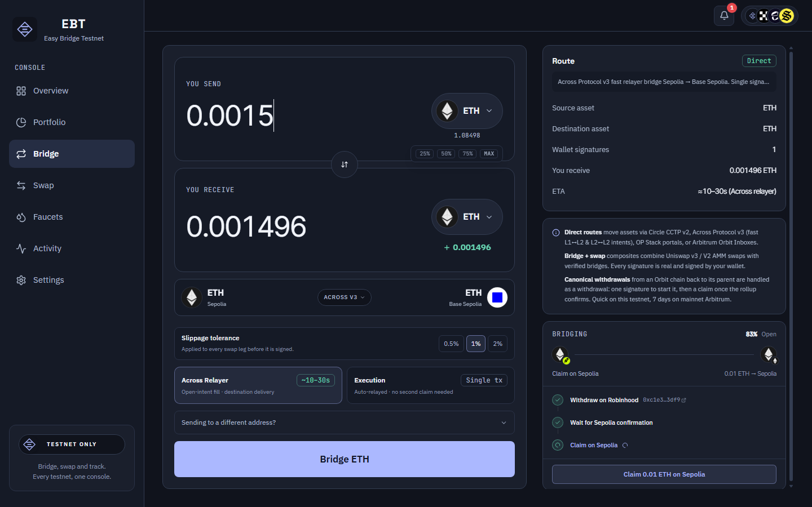

## What it is

| Area | What you can do |
| --- | --- |
| Portfolio | One total across 83 active testnets, per token and per chain |
| Bridge | Find a route, read the fee and ETA, sign once, claim when the destination needs it |
| Swap | Uniswap v3 plus any custom V2 DEX you add, with price impact and a minimum received |
| Faucets | Jump straight to the faucet of the chain you are short on |
| Activity | Local ledger of every transfer started from this browser, with a recover path |
| Settings | Theme, wallets, custom DEX and token imports, all stored on device |

## What it is not

- **Not mainnet.** Every chain, token and RPC in this build is a testnet. Nothing here moves real value.
- **Not a wallet.** EBT never sees a seed phrase or a private key. Your wallet signs everything.
- **Not a service.** There is no server to trust and no database to breach. Balances are read from
  public RPCs and the activity list lives in `localStorage` on your machine.
- **Not financial advice.** Testnet tokens have no price. Fiat numbers are display-only estimates.

## Overview

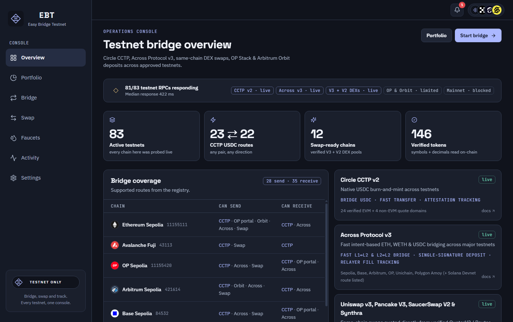

The landing screen is the live registry: every RPC probed, every route counted, and the chains
that have no verified provider listed as such instead of hidden. Numbers move when a provider
moves.

## Portfolio

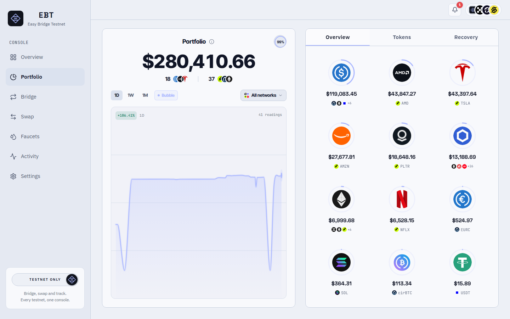

- The headline is the sum of every supported chain for the connected wallets. Disconnect one and
  the number drops, because it is the total of what is connected right now.
- The **rings** show each asset's share of the portfolio. They have no dollar target: whatever the
  portfolio holds, shares add up to 100%, so the biggest holding fills the most.
- The **chart** plots only readings this browser has recorded. A first visit shows one dot on a
  dashed guide instead of an invented flat line, and the line fills in as you come back.
- Assets that cannot be verified on-chain stay in their own group with no price, so a spam token
  cannot borrow the price or the logo of a real one.
- **Tokens** lists everything per chain, with a manual **Import ERC-20** for anything the indexer
  missed. **Recovery** finds assets that arrived without being listed.
- The refresh button doubles as the scan indicator: a ring and a percentage fill in place, so the
  page never jumps while chains are answering.

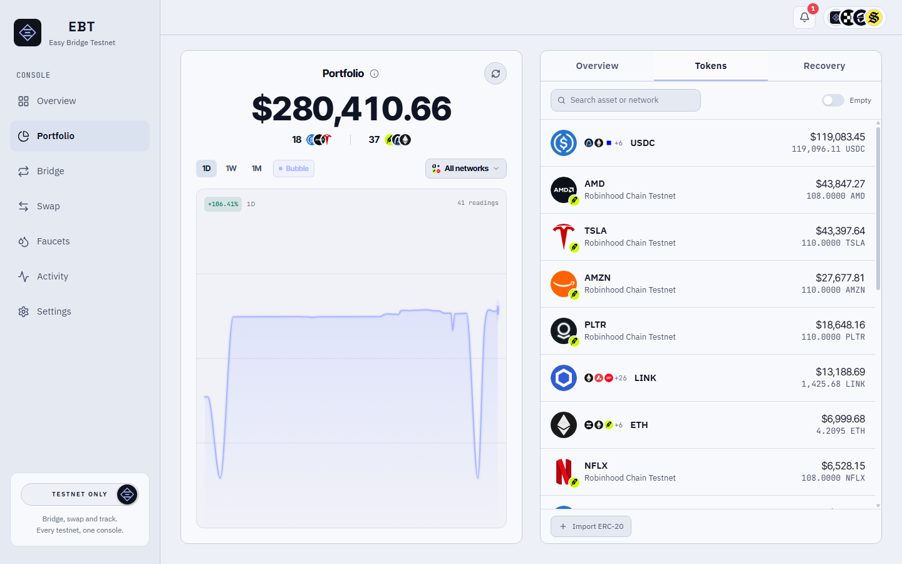

### Sending and receiving

- Sending is enabled for EVM accounts and validates the destination against the wallet family you
  picked, so a Solana field says "not a valid Solana address" instead of an EVM error.
- Non-EVM accounts are **receive-only** in this build. The send picker does not offer them, and the
  token sheet explains the limitation instead of hiding it behind a dead button.
- The address sheet has **copy** and **QR** views, and a paste is checked as you type.

## Bridge


1. Pick the source chain and asset (the amount field shows your balance).
2. Pick the destination chain and asset. EBT scans the routes it knows and picks the cheapest.
3. Read **You receive**, the route badge, the relayer, the ETA and the slippage you are willing to
   take. If a quote cannot be filled, the reason is printed instead of a silent `0.0`.
4. **Bridge** asks the wallet for one signature. Some routes finish in a single transaction, others
   need a claim on the destination chain, and the UI tells you which one you are on.
5. The transfer shows up in **Activity**, with the source hash and a claim button when needed.

Routes included: Across v3, Circle CCTP v2, Stargate, Wormhole, OP Stack portal deposits and
Orbit withdrawals, plus LI.FI and Relay when their testnet endpoints answer. Route discovery is
deduplicated, so the same path never appears twice under different names.

## Swap

<p align="center">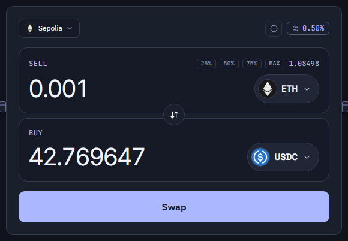</p>

- Quotes Uniswap v3 first, then any V2 DEX you added in Settings.
- Shows rate, price impact, minimum received, route and pool fee before you sign.
- Approvals are only requested when the input is an ERC-20, and only for the exact amount.
- The swap is blocked while the quote is refreshing, so a fast click cannot sign a stale size.

## Faucets, Activity, Settings

| Faucets | Activity |
| --- | --- |
| 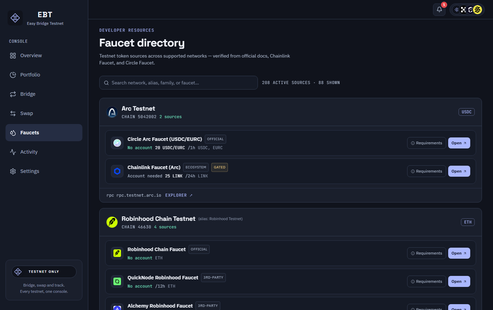 | 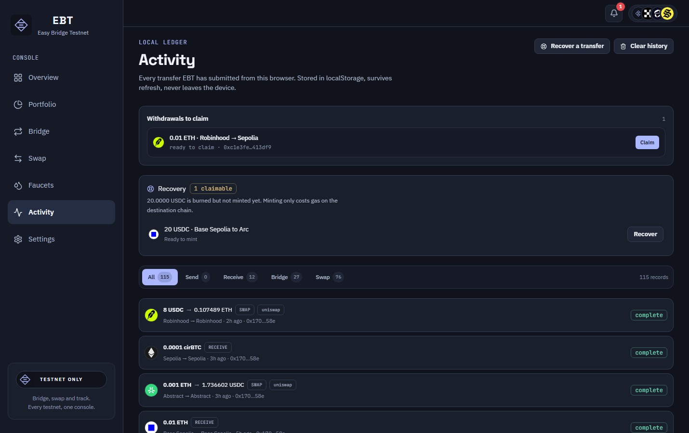 |

- **Faucets** groups the official testnet faucets by chain, with what each one drips.
- **Activity** is a local ledger: every send, bridge and swap started from this browser, stored in
  `localStorage`, with filters, explorer links and a **Recover** flow for transfers that need a claim.
- **Settings** holds the theme, the wallet list, custom DEX contracts and imported tokens.

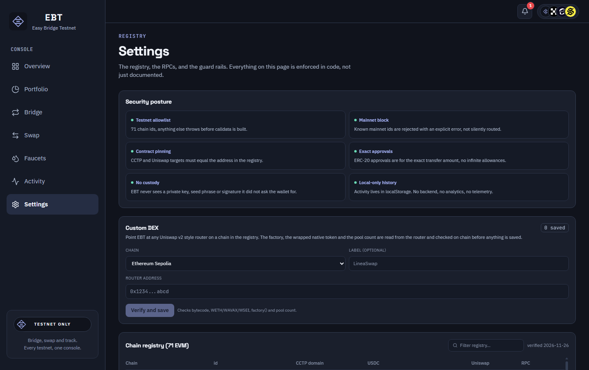

## Wallets and notifications

| Connected wallets | Pending transfer |
| --- | --- |
| 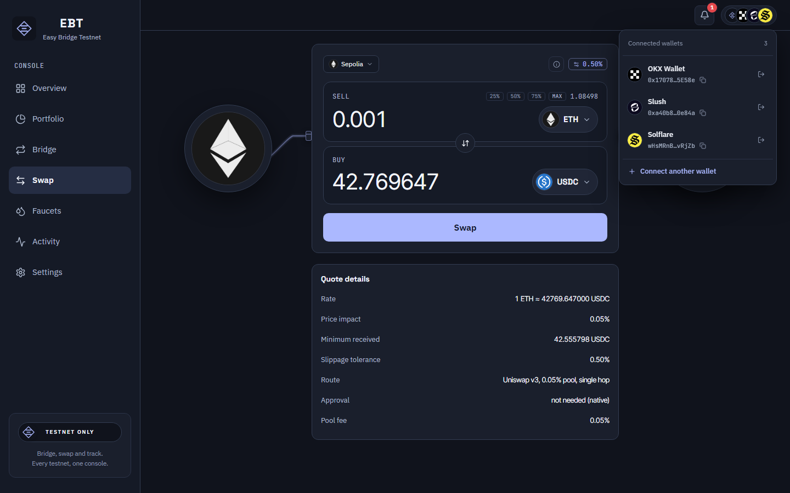 | 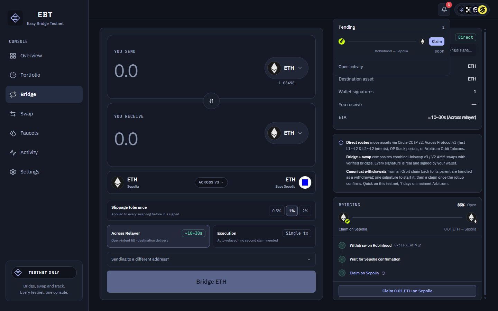 |

Several wallets can be connected at once (EVM plus non-EVM accounts), and the bell tracks every
transfer that still needs a claim, so a bridge you close is never lost.

## Light theme and mobile

<p align="center">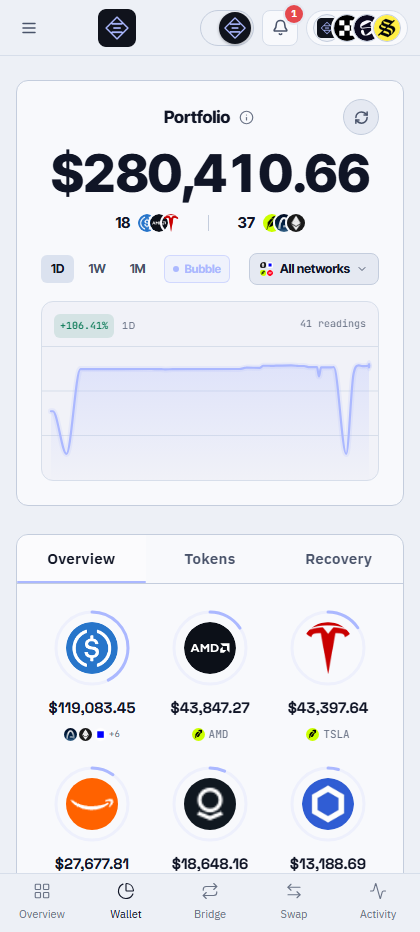</p>

Both themes share one accent ramp, and the layout collapses to a bottom bar on small screens.
The portfolio shots above are light mode; every other screen is shown in dark mode.

## Chains

- **83 active testnets**, including Ethereum Sepolia, Base Sepolia, Arbitrum Sepolia, OP Sepolia,
  Polygon Amoy, Scroll Sepolia, Linea Sepolia, Unichain Sepolia, Ink Sepolia, World Chain Sepolia,
  Zora Sepolia, Celo Alfajores and dozens of newer testnets.
- Non-EVM coverage: Solana Devnet, Sui Testnet, Aptos Testnet, Starknet Sepolia, Stellar
  Testnet, Algorand Testnet, NEAR Testnet, Noble Testnet, Polkadot Westend, XRP Ledger Testnet,
  Canton DevNet and TestNet, and more.

The full list, with RPCs and token addresses, is in [`src/config/chains.ts`](src/config/chains.ts).

## Architecture

```
browser
  ├─ React 19 + Vite + Tailwind
  ├─ wagmi / viem  ──reads──▶  public testnet RPCs
  │                 ──signs──▶  your wallet (injected or WalletConnect)
  ├─ route APIs    ──quotes─▶  Circle Iris, Across, LI.FI, Relay
  └─ localStorage  ──state──▶  activity, settings, value history
```

There is no server component. That is a deliberate choice: nothing to deploy, nothing to breach,
and no place where a key could be collected.

## Quick start

Requirements: Node 20 or newer.

```bash
git clone https://github.com/<you>/EBT.git
cd EBT
npm install
npm run dev          # http://localhost:5178
```

Production build:

```bash
npm run build        # type-check + bundle into dist/
npm run preview      # serve dist/ locally
```

No environment variables are required. `.env.example` documents this and lists the two optional
values (a WalletConnect project id and RPC overrides).

## Tests

These run without a wallet and without network writes:

```bash
npm run test:routes    # route discovery, dedupe and metadata
npm run test:sim       # quote simulation for bridge and swap legs
npm run test:history   # value-chart identity rules
npm run test:address   # receiver validation per wallet family
```

## Local development signer (optional)

`scripts/test-wallet-server.mjs` is a loopback-only JSON-RPC signer for UI work: it reads a
git-ignored `.test-wallet.json` and signs on testnets so you can click through flows. It is a dev
tool, it is not part of the app bundle, and it refuses to run outside `127.0.0.1`. Never point it
at a funded key.

## Security

- No private keys, seed phrases or API secrets in the repository or its history.
- Strict Content Security Policy, no inline scripts, no `eval`.
- Every external URL is validated, every quote is sanity-checked, every amount is bounded.
- Token prices apply only to verified contracts, so a copycat token cannot inflate a total.
- See [SECURITY.md](SECURITY.md) for the threat model, the dependency advisory notes and how to
  report a problem.

## Contributing

Issues and pull requests are welcome. Please keep the testnet-only rule, run the tests above, and
describe what you verified.

## License

[MIT](LICENSE)
